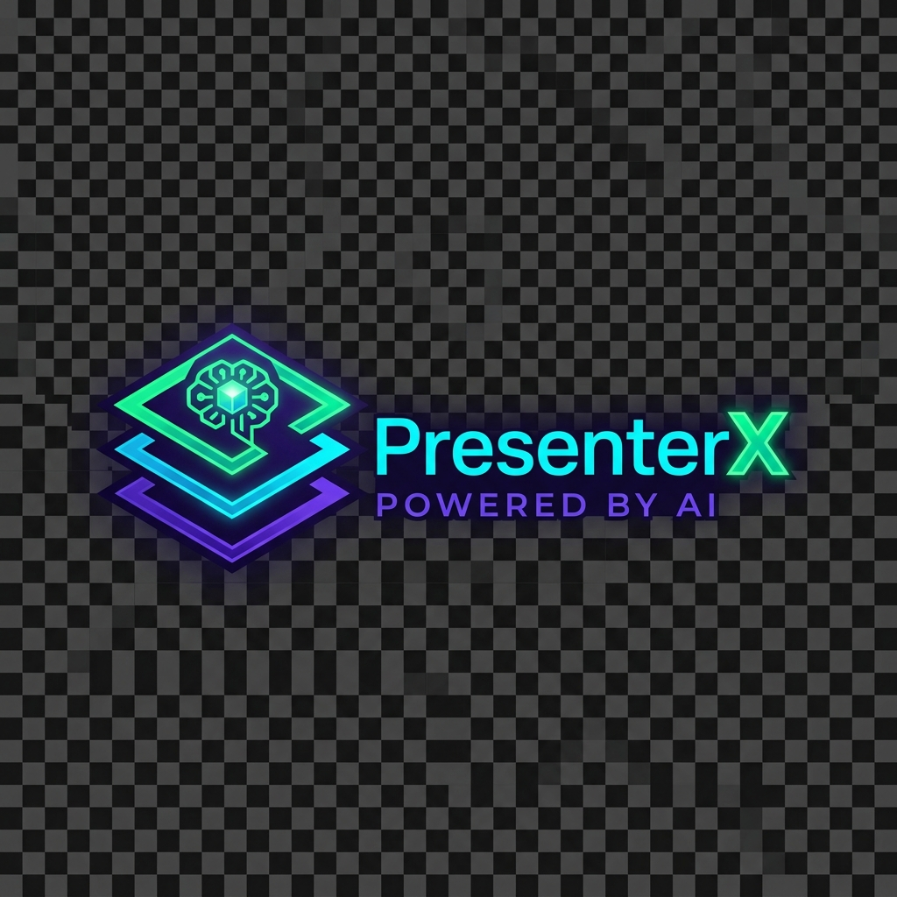
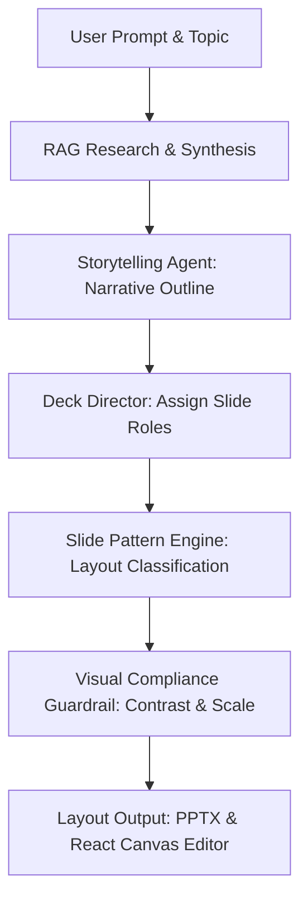
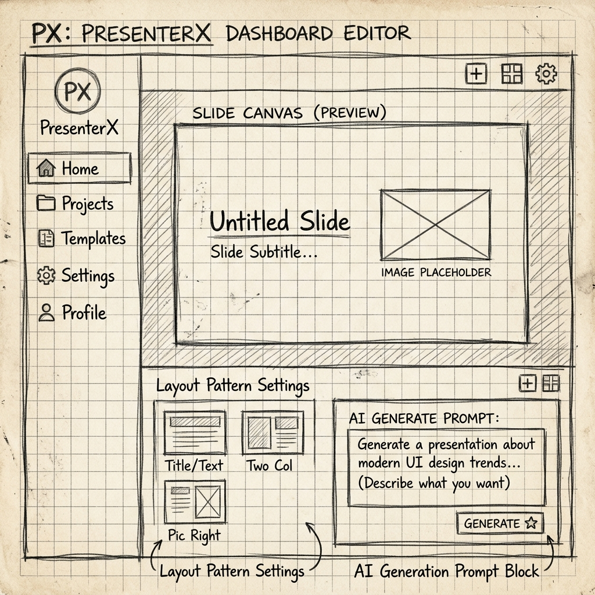
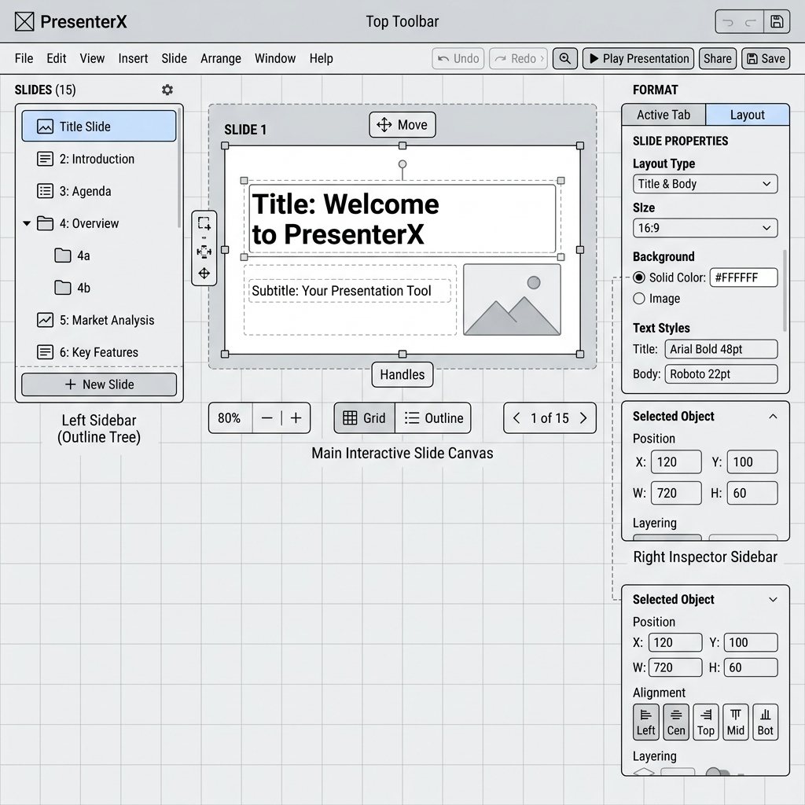
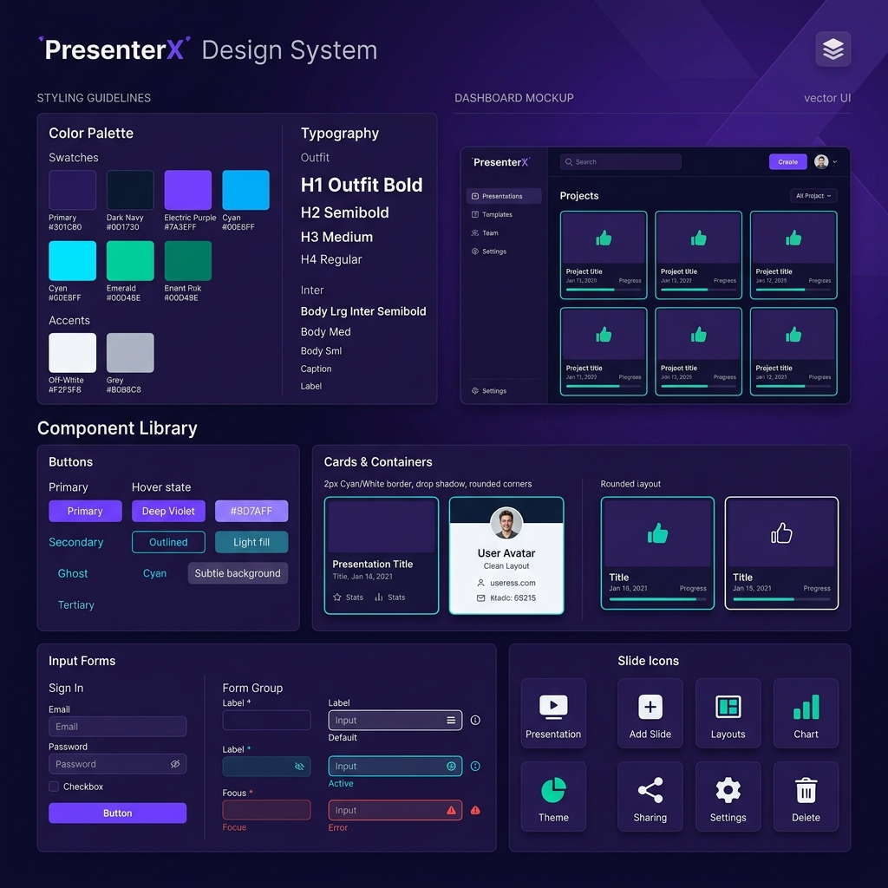
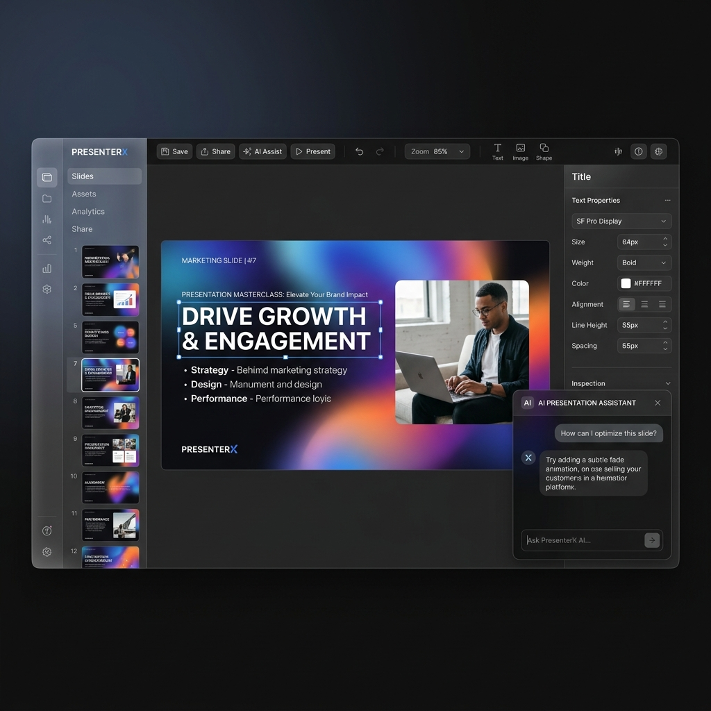

# PresenterX — UI/UX Case Study: Designing the AI Presentation OS

PresenterX is an agentic AI workspace built to transform raw text and prompts into McKinsey-grade presentations in under 90 seconds. This case study documents the design journey, user experience framework, visual identity, and product layouts.

---

## 📌 Brand Logo

---

## 📖 Project Overview & Objectives
Traditional presentation builders (PowerPoint, Keynote) require heavy manual styling and alignment work. First-generation AI builders (e.g. Gamma) generate layouts, but frequently suffer from visual monotony, low-quality text hierarchy, and a lack of structured design intelligence. 

PresenterX resolves this by incorporating a **Pattern Engine** between content generation and layout rendering, dynamically mapping content syntax into structural layouts like roadmaps, feature grids, timelines, architecture layers, and TAM/SAM/SOM charts.

### Key UX Goals:
1. **Reduce Time-to-Draft**: From user prompt to a visual, well-structured presentation deck in under 90 seconds.
2. **Eliminate Placeholder Formatting**: Ensure all shapes, cards, and diagrams are natively populated with actual relevant content.
3. **Strict Legibility & Compliance**: Guarantee a minimum of 4.5:1 WCAG AA color contrast ratios and readable font sizes across all viewing environments.

---

## 🔍 User Research & Personas
Through user interviews with consultants, product manager, and startup founders, we identified three core personas:

### Persona A: Sarah, Startup Founder
* **Needs**: Rapidly iterate on pitch decks, tam/sam/som market sizing, and competitive matrices without hiring a graphic designer.
* **Pain Points**: Re-aligning bullet points and styling boxes takes hours away from business growth.

### Persona B: David, Management Consultant
* **Needs**: Create dense, data-driven slides containing timeline milestones and architecture diagrams that look highly polished.
* **Pain Points**: AI tools generate overly simplified, casual-looking slides that lack consulting-grade structure.

---

## 🧭 Information Architecture & User Flow
PresenterX utilizes a pipeline that splits layout generation into specialized stages:

---

## ✏️ Wireframing & Layout Evolution

### 1. Lo-Fi Wireframe (Conceptual Layout Sketch)
The conceptual phase focused on maximizing canvas size while providing an interactive AI Copilot sidebar that gives the user direct, contextual control.

* **Key Elements**: Left sidebar for document structure/outline, central presentation canvas, right panel for quick design presets, and a bottom prompt input box for instant AI restructuring.

### 2. Mid-Fi Wireframe (Functional Workspace Blueprint)
The mid-fidelity wireframe translates these conceptual blocks into interactive UI components, sizing constraints, and detailed placement layout grids.

* **Key Elements**: Distinct visual grids, card container placeholders with 2px borders, timeline milestones, and precise typography spacing coordinates.

---

## 🎨 Visual Identity & Design System
PresenterX adopts a futuristic dark mode design system inspired by Apple-style minimalism and Stripe-style typography clarity.

* **Color Palette**:
  * **Primary Background**: Deep Velvet Dark Navy (`#02020D`)
  * **Text/Primary Contrast**: Electric Pearl White (`#F5F5F7` / `#F8F9FC`)
  * **Accent Accents**: Tech Cyan (`#00FFFF`) and Neon Purple (`#635BFF`)
* **Typography**:
  * **Display & Titles**: Outfit Variable (36px - 60px)
  * **Body Copy**: Inter Variable (14px - 18px)
* **Card Containers**: 2px border strokes with realistic shadows to ensure high contrast and pop.

---

## 💼 Subscription & Business Model
PresenterX offers a multi-tiered SaaS pricing model designed to accommodate casual users, professional teams, and API-heavy enterprise clients.

| Tier | Price | Target Audience | Features |
| :--- | :--- | :--- | :--- |
| **Free Creator** | $0 | Casual presenters | 5 presentations/month, standard templates, watermarked PDF/PPTX exports. |
| **Pro Studio** | $24 / mo | Consultants & Designers | Unlimited presentations, custom brand kits, private RAG web search, unlimited PPTX exports, co-pilot editor. |
| **Enterprise OS** | $79 / seat / mo | Agencies & Corporates | Single Sign-On (SSO), workspace data isolation, custom fine-tuned LLM styles, team collaboration comments. |
| **API Custom** | Pay-as-you-go | Developers & Platforms | Programmatic presentation generation API, custom templates JSON mapping, high-speed rendering. |

---

## 🖥️ Final High-Fidelity UI Showcase
The final interface delivers a premium, immersive Apple-style dark mode workspace. 

* **Features**:
  * **Floating Glassmorphism Canvas**: Presentation slides appear elevated above a deep space background grid.
  * **Smart Inspector**: Allows users to switch slide patterns instantly (e.g. convert a feature grid to a competitive table with one click).
  * **Integrated AI Copilot Chat**: Let users command changes like *"enlarge text on this slide"* or *"make this card layout green"* in real-time.
